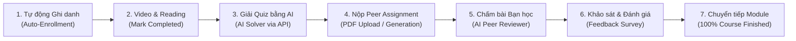
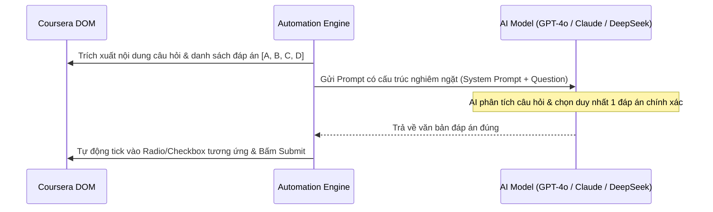
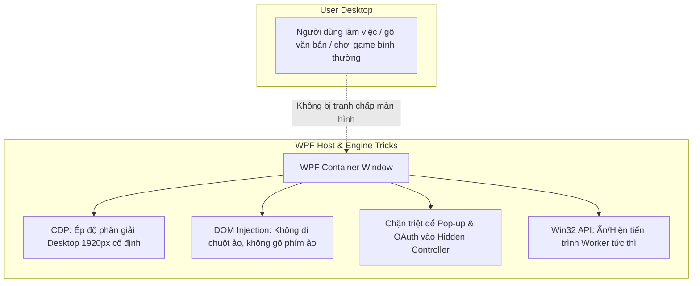
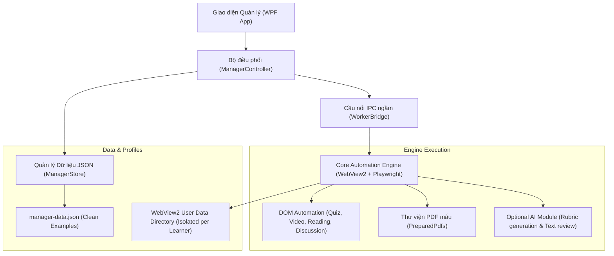

# 🎓 Coursera Automation Suite (ACOSE Customer Manager)

<p align="center">
  
  
  
  
  
</p>

> **Giải pháp Desktop toàn diện hỗ trợ quản lý học viên và tự động hóa học tập trên nền tảng Coursera.**  
> Được thiết kế theo kiến trúc module hóa với giao diện WPF hiện đại, tích hợp Microsoft WebView2 & Playwright Engine, hỗ trợ chạy song song đa luồng và cách ly hồ sơ trình duyệt an toàn.

<p align="center">
  
</p>

---

## 📌 1. Giới thiệu tổng quan

**Coursera Automation Suite** là công cụ dành cho việc quản lý tiến độ học tập và tự động hóa các hoạt động trên nền tảng Coursera. Hệ thống giải quyết trọn vẹn vòng đời học tập từ khâu ghi danh, làm bài tập, chấm điểm đồng đẳng cho tới khi hoàn tất khóa học.

Ứng dụng được thiết kế sẵn ở dạng **Template & Example Out-Of-The-Box**: Toàn bộ dữ liệu nhạy cảm đã được làm sạch, người dùng chỉ cần tải về, mở lên là có thể trải nghiệm ngay với dữ liệu minh họa hoặc phát triển thêm tính năng theo nhu cầu cá nhân.

---

## ⚡ 2. Quy trình Tự động hóa Khép kín từ A đến Z (100% End-to-End Automation)

Hệ thống được thiết kế để hoàn thành trọn vẹn một khóa học từ lúc bắt đầu cho đến khi đạt chứng chỉ 100% mà **không cần con người can thiệp thủ công**:



### Chi tiết các dạng bài tập & hoạt động được xử lý:

| STT | Dạng hoạt động / Bài tập | Cơ chế xử lý chi tiết & Tự động hóa | Trạng thái |
|:---:|:---|:---|:---:|
| **1** | **Trắc nghiệm kiến thức (Quizzes & Graded Assessments)** | • **Giải bài bằng AI qua API Key**: Tự động bóc tách đề bài, câu hỏi đơn/nhiều lựa chọn và gửi prompt tối ưu sang AI (GPT-4o, Claude 3.5, DeepSeek).<br>• AI trả lời chính xác đáp án cần chọn, engine tự tick vào radio/checkbox và bấm Submit.<br>• Kiểm tra điểm số đạt yêu cầu (passing score).<br>• **Cơ chế Hoãn bài (Deferred Quiz Queue)**: Nếu bài quiz bị Coursera giới hạn số lần làm trong ngày (cooldown 8h/24h), engine tự động đưa bài vào hàng đợi chờ và thử lại khi hết thời gian phạt. | ✅ 100% Auto |
| **2** | **Bài tập tự luận lớn (Peer-graded Assignments)** | • **Chế độ Thư viện PDF (`PreparedPdfs`)**: Tự động tra cứu file PDF soạn sẵn theo slug khóa học và tên bài tập trong thư mục `PreparedPdfs/<course-slug>/`.<br>• Hook trực tiếp vào Chrome DevTools Protocol (CDP) để đẩy file vào input ẩn / Uppy uploader.<br>• **Chế độ Sinh nội dung theo Rubric**: AI đọc tiêu chí chấm điểm, render ra tài liệu PDF chuẩn A4/Unicode in-memory.<br>• Thuật toán kiểm tra trùng lặp câu chữ (overlap containment $\le 55\%$) và kiểm soát giới hạn số từ (word-count constraint). | ✅ 100% Auto |
| **3** | **Chấm bài bạn học (Peer Review / Peer Grading)** | • Tự động nhận bài của học viên khác cần đánh giá (`review-next`, `give-feedback`).<br>• AI phân tích bài làm của bạn học theo từng tiêu chí rubric thành phần và chấm điểm hợp lý.<br>• Tự động tạo nhận xét/góp ý có ý nghĩa bằng tiếng Anh, đáp ứng độ dài ký tự tối thiểu của Coursera.<br>• Cơ chế điền form theo từng tick DOM và xác nhận nộp review an toàn. | ✅ 100% Auto |
| **4** | **Diễn đàn thảo luận (Discussion Forums)** | • Quét và nhận diện câu hỏi gợi ý trong diễn đàn môn học.<br>• AI đóng vai học viên tự sinh bài luận thảo luận ngắn 3-4 câu tiếng Anh học thuật để post lên diễn đàn.<br>• Lưu nhật ký nộp bài (`DiscussionSubmissionJournal`) ngăn chặn phản hồi trùng lặp. | ✅ 100% Auto |
| **5** | **Tài liệu đọc & Video bài giảng (Readings & Videos)** | • Tự động duyệt qua nội dung bài giảng video và tài liệu đọc bổ trợ.<br>• Tự động gửi tín hiệu hoàn tất mục học (Mark as completed) lên máy chủ Coursera. | ✅ 100% Auto |
| **6** | **Khảo sát & Đánh giá khóa học (Feedback & Surveys)** | • Tự động hoàn thành các biểu mẫu khảo sát chất lượng sau khi kết thúc module hoặc sau bài quiz.<br>• Xử lý an toàn DOM routes và phạm vi câu hỏi khảo sát. | ✅ 100% Auto |
| **7** | **Hoạt động bổ trợ / Tùy chọn (Optional & Ungraded / LTI Items)** | • Nhận diện các hoạt động tùy chọn, plugin ngoài, bài thực hành không tính điểm (Ungraded App Items, Practice App Items, LTI tools).<br>• Bỏ qua an toàn hoặc hoàn thành nhanh để tránh kẹt luồng học. | ✅ 100% Auto |
| **8** | **Tự động ghi danh (Course Enrollment)** | • Tự động phát hiện tài khoản chưa đăng ký môn học và thực hiện ghi danh tự động (Enrollment).<br>• Bỏ qua các pop-up quảng cáo gói trả phí / Coursera Plus hoặc liên kết tổ chức. | ✅ 100% Auto |
| **9** | **Điều hướng module liên tục (Course Continuation)** | • Tự động theo dõi tiến độ tuần học và chuyển tiếp sang module kế tiếp cho tới khi hoàn tất 100% toàn bộ khóa học. | ✅ 100% Auto |

---

## 🧠 3. Tích hợp AI Giải bài tập bằng API Key (AI-Powered Engine)

Hệ thống tích hợp dịch vụ `AiCompletionService` linh hoạt, hỗ trợ kết nối với các mô hình ngôn ngữ lớn (LLM) thông qua API Key cá nhân của người dùng:



### Các tác vụ AI đảm nhiệm:
1. **Giải trắc nghiệm (Quiz Solver)**: Trích xuất câu hỏi và các lựa chọn, gửi prompt yêu cầu AI chọn duy nhất đáp án chính xác nhất mà không thêm lời giải thích thừa.
2. **Viết bài thảo luận (Discussion Generator)**: Đóng vai học viên viết bài luận ngắn (3-4 câu tiếng Anh học thuật) liên quan trực tiếp đến chủ đề bài học.
3. **Chấm bài bạn học (Peer Reviewer)**: Đọc rubric bài làm của bạn học, chấm điểm và viết lời nhận xét chi tiết đạt yêu cầu độ dài.
4. **Sinh bài tập PDF (Peer Assignment Generator)**: Phân tích tiêu chí rubric của đề bài, tự sinh bài làm hoàn chỉnh và render ra file PDF chuẩn A4.

---

## 🖥️ 4. Các Kỹ thuật Chạy ngầm trong WPF không can thiệp màn hình (Background Automation Hacks)

Một trong những ưu điểm kỹ thuật vượt trội nhất của công cụ là **khả năng chạy ngầm hoàn toàn mà không cướp chuột, cướp phím hay làm gián đoạn công việc của người dùng**:



### 1. Ép độ phân giải Desktop 1920px bằng Chrome DevTools Protocol (CDP)
* **Vấn đề của Coursera**: Khi thu nhỏ cửa sổ trình duyệt (hoặc chạy trong cửa sổ kích thước nhỏ), CSS Media Queries của Coursera sẽ tự động kích hoạt giao diện Mobile, làm **ẩn thanh sidebar điều hướng và ẩn nút nộp bài**.
* **Giải pháp**: Engine can thiệp sâu vào CDP bằng lệnh `Emulation.setDeviceMetricsOverride`, ép trình duyệt luôn hoạt động ở chế độ Desktop chuẩn (`width: 1920px`) và tự động co tỉ lệ (`scale`) vừa vặn vào khung WPF. Sidebar và nút bấm luôn hiển thị đầy đủ 100%.

### 2. Không chiếm chuột và bàn phím (Zero Focus-Stealing)
* Tất cả thao tác click nút, tick chọn đáp án trắc nghiệm, cuộn trang đều được thực thi trực tiếp qua **JavaScript DOM Injection (`ExecuteScriptAsync`)** và **CDP Protocol**.
* Engine **hoàn toàn không sử dụng chuột ảo hệ điều hành** (như `SendKeys` hay `mouse_event`). Người dùng có thể thoải mái gõ văn bản, lướt web, làm việc hoặc chơi game trên cùng chiếc máy tính mà không sợ bị click nhầm.

### 3. Điều khiển Ẩn / Hiện cửa sổ Worker linh hoạt qua Win32 API
* Tích hợp bộ điều khiển HWND trong `WorkerWindow.cs`, sử dụng API `ShowWindowAsync` của Windows (`user32.dll`).
* Người dùng có thể bấm nút **"Ẩn"** để ẩn hoàn toàn cửa sổ WebView2 của khóa học xuống chạy ngầm tiết kiệm tài nguyên, hoặc bấm **"Hiện"** để mở lại theo dõi thời gian thực.

### 4. Chặn Pop-up và gắn luồng ngoài vào Hidden Controller
* Lắng nghe sự kiện `CoreWebView2.NewWindowRequested` để chặn đứng các pop-up quảng cáo, đăng ký gói trả phí Coursera Plus hoặc liên kết bên ngoài.
* Các liên kết LTI công cụ ngoài được điều hướng vào danh sách controller ẩn (`_hiddenLtiControllers`), không bao giờ bị văng cửa sổ ra giữa màn hình.

### 5. In PDF hoàn toàn trong InPrivate Hidden WebView2
* Khâu sinh bài tập PDF tự động sử dụng một WebView2 controller ẩn riêng biệt với chế độ InPrivate, in tài liệu trực tiếp in-memory ra file A4 chuẩn Unicode mà không điều hướng hay làm gián đoạn tab học tập chính.

---

## 🛠️ 5. Kiến trúc hệ thống



### Điểm nổi bật về mặt kỹ thuật:
1. **Cách ly Profile hoàn toàn**: Mỗi học viên sở hữu một thư mục dữ liệu trình duyệt WebView2 độc lập, không dùng chung cookie hay phiên đăng nhập, chống văng tài khoản.
2. **Chế độ "Mở kiểm tra" (Inspection Mode)**: Cho phép mở trình duyệt với đúng profile và link khóa học để người dùng xem xét, thao tác thủ công khi cần mà không kích hoạt auto.
3. **Ẩn / Hiện cửa sổ Worker**: Tùy chỉnh ẩn cửa sổ trình duyệt để chạy ngầm tiết kiệm tài nguyên hoặc hiện lên để quan sát thời gian thực.
4. **Chạy song song đa luồng (`MaxParallel`)**: Cấu hình chạy đồng thời nhiều khóa học cùng lúc tùy thuộc vào cấu hình phần cứng máy tính.
5. **Độc lập và Không phụ thuộc bắt buộc vào AI**:
   - Hệ thống hoạt động **100% độc lập ở chế độ tiêu chuẩn** thông qua cơ chế rule-based DOM automation và thư viện PDF soạn sẵn (`PreparedPdfs`).
   - Tính năng AI là tùy chọn mở rộng (Optional Pluggable). Không hardcode API key hay phụ thuộc vào bất kỳ dịch vụ AI bí mật nào.

---

## 🚀 6. Hướng dẫn bắt đầu nhanh (Quick Start)

### Yêu cầu môi trường
* **Hệ điều hành**: Windows 10 / Windows 11 (64-bit)
* **.NET Runtime**: [.NET 10.0 Runtime](https://dotnet.microsoft.com/download/dotnet/10.0) (hoặc .NET 10.0 SDK nếu muốn tự biên dịch)
* **Microsoft Edge WebView2 Runtime**: Đã tích hợp sẵn trên Windows 10/11 hiện đại.

### Cài đặt & Chạy ứng dụng

1. **Clone repository về máy**:
   ```bash
   git clone https://github.com/Namnoname101/CustomerManager-Acore.git
   cd CustomerManager-Acore
   ```

2. **Khởi chạy ứng dụng**:
   * **Cách 1 (Dùng file thực thi đã biên dịch)**:
     Nhấp đúp vào tệp `Acose.CustomerManager.exe` ở thư mục gốc.
   * **Cách 2 (Biên dịch từ mã nguồn)**:
     ```bash
     dotnet build Source/Acose.CustomerManager.csproj -c Release
     dotnet run --project Source/Acose.CustomerManager.csproj
     ```

3. **Giao diện mẫu sẵn sàng**:
   * Ứng dụng sẽ tự động tải dữ liệu minh họa từ `Data/manager-data.json`.
   * Bạn có thể bấm **"Thêm khách / đơn thủ công"**, nhập tên và link khóa học Coursera cần học để bắt đầu.

---

## 📂 7. Hướng dẫn cấu hình dữ liệu & File mẫu

### 7.1. Dữ liệu học viên (`Data/manager-data.json`)
File dữ liệu mẫu được cung cấp tại `Data/manager-data.json` (và bản tham khảo `Data/manager-data.example.json`). Cấu trúc:
```json
{
  "Version": 1,
  "MaxParallel": 5,
  "Orders": [
    {
      "Id": "00000000000000000000000000000001",
      "Name": "NGUYEN MINH ANH",
      "ProfilePath": "Data\\Profiles\\example-user-1",
      "Source": "Thủ công",
      "Courses": [
        {
          "Id": "10000000000000000000000000000001",
          "Url": "https://www.coursera.org/learn/learning-how-to-learn",
          "Progress": 65,
          "State": 3,
          "Activity": "Đang xử lý nội dung trong Module 3."
        }
      ]
    }
  ]
}
```

### 7.2. Thư viện bài nộp PDF (`PreparedPdfs/`)
Để tool tự động nộp bài tập Peer Assignment bằng PDF của bạn:
1. Vào thư mục `PreparedPdfs/`.
2. Tạo thư mục con có tên là **slug của khóa học** (phần sau `/learn/` trên URL Coursera).
3. Đặt file PDF bài làm vào thư mục này với tên chứa tiêu đề bài tập hoặc slug bài tập.
   * *Ví dụ*: Với khóa học `https://www.coursera.org/learn/uva-darden-experiencing-design`, bài tập là `personal-development-plan-pdp`, cấu trúc file sẽ là:
     ```text
     PreparedPdfs/
       uva-darden-experiencing-design/
         personal-development-plan-pdp.pdf
     ```

### 7.3. Cấu hình AI mở rộng (Tùy chọn)
Nếu bạn muốn sử dụng tính năng AI để tự động sinh bài tập PDF theo rubric hoặc viết nội dung thảo luận:
* Tham khảo file cấu hình mẫu tại `Data/engine-settings.example.json`.
* Thiết lập các biến môi trường trên máy của bạn (hoặc cấu hình qua UI):
  ```bash
  # Chuyển chế độ sang 'ai' (mặc định là 'prepared')
  set ACOSE_PEER_PDF_MODE=ai
  
  # Khóa API cá nhân của bạn (hỗ trợ OpenAI / Claude / Gemini qua Router tương thích)
  set AGENTROUTER_API_KEY=your_actual_api_key_here
  set AGENTROUTER_MODEL=gpt-4o
  ```

---

## 📁 8. Cấu trúc thư mục dự án

```text
├── Source/                             # Toàn bộ mã nguồn C# và giao diện WPF
│   ├── UI/                             # Giao diện XAML và Code-behind (MainWindow)
│   ├── Runtime/                        # Cầu nối IPC, quản lý tiến trình Worker WebView2
│   ├── ManagerController.cs            # Controller điều phối tác vụ và luồng chạy
│   ├── ManagerStore.cs                 # Xử lý lưu trữ JSON và sao lưu dự phòng
│   └── Models.cs                       # Định nghĩa thực thể dữ liệu & quy tắc xác thực
├── Engine/                             # Core tự động hóa thực thi (WebView2 + Playwright)
├── Data/                               # Thư mục dữ liệu cục bộ
│   ├── manager-data.json               # Dữ liệu khách hàng mẫu (Sanitized Example)
│   ├── manager-data.example.json       # Tệp JSON mẫu đối chiếu
│   └── engine-settings.example.json    # Hướng dẫn cấu hình tùy chọn
├── PreparedPdfs/                       # Kho tài liệu PDF mẫu dùng cho bài nộp Peer Review
│   └── HUONG-DAN.md                    # Chi tiết quy chuẩn đặt tên file PDF
├── .gitignore                          # Danh sách loại trừ an toàn cho Git
└── README.md                           # Tài liệu hướng dẫn sử dụng
```

---

## 🔒 9. Bảo mật & Miễn trừ trách nhiệm

* **Bảo vệ quyền riêng tư**: Không có thông tin người dùng, mật khẩu, cookies hay mã token bí mật nào được lưu trữ trong mã nguồn hoặc đẩy lên repository.
* **Mục đích nghiên cứu & học tập**: Dự án được xây dựng nhằm mục đích nghiên cứu công nghệ tự động hóa trình duyệt (Browser Automation) và tối ưu hóa trải nghiệm quản lý học tập. Người sử dụng cần tuân thủ Điều khoản Dịch vụ của nền tảng Coursera khi áp dụng vào thực tế.

---

## 🤝 10. Đóng góp & Phát triển mở rộng

Mọi đóng góp, báo lỗi hoặc đề xuất tính năng mới đều được hoan nghênh:
1. Fork repository.
2. Tạo nhánh tính năng (`git checkout -b feature/NewFeature`).
3. Commit thay đổi (`git commit -m 'Add some feature'`).
4. Push lên nhánh (`git push origin feature/NewFeature`).
5. Mở Pull Request để thảo luận.
