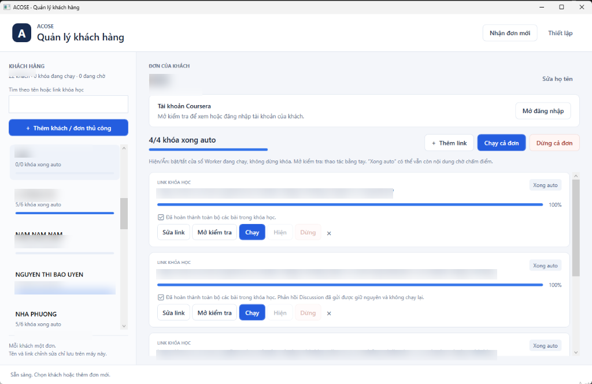
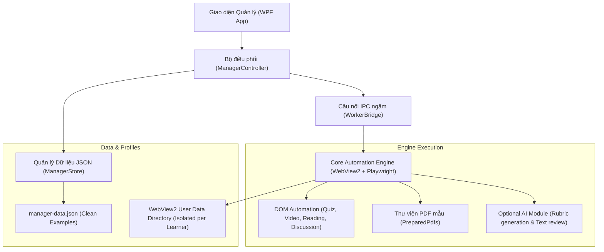

# 🎓 Coursera Automation Suite (ACOSE Customer Manager)

<p align="center">
  
  
  
  
  
</p>

> **Giải pháp Desktop toàn diện hỗ trợ quản lý học viên và tự động hóa học tập trên nền tảng Coursera.**  
> Được thiết kế theo kiến trúc module hóa với giao diện WPF hiện đại, tích hợp Microsoft WebView2 & Playwright Engine, hỗ trợ chạy song song đa luồng và cách ly hồ sơ trình duyệt an toàn.

<p align="center">
  
</p>

---

## 📌 1. Giới thiệu tổng quan

**Coursera Automation Suite** là công cụ dành cho việc quản lý tiến độ học tập và tự động hóa các hoạt động trên nền tảng Coursera. Hệ thống giải quyết trọn vẹn vòng đời học tập từ khâu ghi danh, làm bài tập, chấm điểm đồng đẳng cho tới khi hoàn tất khóa học.

Ứng dụng được thiết kế sẵn ở dạng **Template & Example Out-Of-The-Box**: Toàn bộ dữ liệu nhạy cảm đã được làm sạch, người dùng chỉ cần tải về, mở lên là có thể trải nghiệm ngay với dữ liệu minh họa hoặc phát triển thêm tính năng theo nhu cầu cá nhân.

---

## ⚡ 2. Danh mục các dạng bài tập được xử lý (Supported Activity Types)

Hệ thống đã nghiên cứu và triển khai tự động hóa trực tiếp trên DOM của Coursera cho đầy đủ các dạng bài tập và hoạt động sau:

| STT | Dạng hoạt động / Bài tập | Cơ chế xử lý chi tiết | Trạng thái |
|:---:|:---|:---|:---:|
| **1** | **Trắc nghiệm kiến thức (Quizzes & Graded Assessments)** | • Nhận diện câu hỏi trắc nghiệm đơn (Single-choice) & trắc nghiệm nhiều đáp án (Multiple-choice).<br>• Tự động mở bài quiz (`QuizOpeningAutomation`), chọn đáp án, nộp bài.<br>• Kiểm tra điểm số đạt yêu cầu (passing score).<br>• Cơ chế hoãn bài và chờ cooldown retry tự động (`DeferredQuizAutomation`). | ✅ Sẵn sàng |
| **2** | **Bài tập tự luận lớn (Peer-graded Assignments)** | • **Chế độ Thư viện PDF (`PreparedPdfs`)**: Tự động tra cứu file PDF soạn sẵn theo slug khóa học và tên bài tập trong thư mục `PreparedPdfs/<course-slug>/`.<br>• Xử lý hộp thoại Upload File, input ẩn, upload file qua Chrome DevTools Protocol (CDP).<br>• Tự động điền tiêu đề bài nộp, kiểm tra tránh nộp trùng bài.<br>• **Chế độ Sinh nội dung theo Rubric (Rubric-based Document Generation)**: Đọc tiêu chí chấm điểm, render ra tài liệu PDF chuẩn A4/Unicode in-memory.<br>• Thuật toán kiểm tra trùng lặp câu chữ (overlap containment $\le 55\%$) và kiểm soát giới hạn số từ (word-count constraint). | ✅ Sẵn sàng |
| **3** | **Chấm bài bạn học (Peer Review / Peer Grading)** | • Tự động nhận bài của học viên khác cần đánh giá (`review-next`, `give-feedback`).<br>• Chấm điểm từng tiêu chí rubric thành phần.<br>• Tự động tạo nhận xét/góp ý có ý nghĩa, đáp ứng độ dài ký tự tối thiểu.<br>• Cơ chế điền form theo tick DOM và xác nhận nộp review an toàn. | ✅ Sẵn sàng |
| **4** | **Diễn đàn thảo luận (Discussion Forums)** | • Quét và nhận diện câu hỏi gợi ý trong diễn đàn môn học.<br>• Tự động tạo nội dung phản hồi thảo luận đạt tiêu chuẩn hoàn thành.<br>• Lưu nhật ký nộp bài (`DiscussionSubmissionJournal`) ngăn chặn phản hồi trùng lặp. | ✅ Sẵn sàng |
| **5** | **Tài liệu đọc & Video bài giảng (Readings & Videos)** | • Tự động mở video bài giảng, lướt qua tài liệu đọc.<br>• Gửi tín hiệu hoàn tất mục học (Mark as completed) lên Coursera. | ✅ Sẵn sàng |
| **6** | **Khảo sát & Đánh giá khóa học (Feedback & Surveys)** | • Tự động hoàn thành các biểu mẫu khảo sát chất lượng khóa học sau khi kết thúc module hoặc sau bài quiz.<br>• Xử lý an toàn DOM routes và phạm vi câu hỏi khảo sát. | ✅ Sẵn sàng |
| **7** | **Hoạt động bổ trợ / Tùy chọn (Optional & Ungraded / LTI Items)** | • Nhận diện các hoạt động tùy chọn, plugin ngoài, bài thực hành không tính điểm (Ungraded App Items, Practice App Items, LTI tools).<br>• Bỏ qua an toàn hoặc hoàn thành nhanh để tránh kẹt luồng học. | ✅ Sẵn sàng |
| **8** | **Tự động ghi danh (Course Enrollment)** | • Tự động phát hiện tài khoản chưa đăng ký môn học và thực hiện ghi danh tự động (Enrollment).<br>• Bỏ qua các pop-up quảng cáo gói trả phí / Coursera Plus hoặc liên kết tổ chức. | ✅ Sẵn sàng |
| **9** | **Điều hướng module liên tục (Course Continuation)** | • Tự động theo dõi module hiện tại và chuyển tiếp sang module kế tiếp khi module trước đã hoàn tất. | ✅ Sẵn sàng |

---

## 🛠️ 3. Kiến trúc hệ thống & Tính năng nâng cao



### Điểm nổi bật về mặt kỹ thuật:
1. **Cách ly Profile hoàn toàn**: Mỗi học viên sở hữu một thư mục dữ liệu trình duyệt WebView2 độc lập, không dùng chung cookie hay phiên đăng nhập, chống văng tài khoản.
2. **Chế độ "Mở kiểm tra" (Inspection Mode)**: Cho phép mở trình duyệt với đúng profile và link khóa học để người dùng xem xét, thao tác thủ công khi cần mà không kích hoạt auto.
3. **Ẩn / Hiện cửa sổ Worker**: Tùy chỉnh ẩn cửa sổ trình duyệt để chạy ngầm tiết kiệm tài nguyên hoặc hiện lên để quan sát thời gian thực.
4. **Chạy song song đa luồng (`MaxParallel`)**: Cấu hình chạy đồng thời nhiều khóa học cùng lúc tùy thuộc vào cấu hình phần cứng máy tính.
5. **Độc lập và Không phụ thuộc bắt buộc vào AI**:
   - Hệ thống hoạt động **100% độc lập ở chế độ tiêu chuẩn** thông qua cơ chế rule-based DOM automation và thư viện PDF soạn sẵn (`PreparedPdfs`).
   - Tính năng AI là tùy chọn mở rộng (Optional Pluggable). Không hardcode API key hay phụ thuộc vào bất kỳ dịch vụ AI bí mật nào.

---

## 🚀 4. Hướng dẫn bắt đầu nhanh (Quick Start)

### Yêu cầu môi trường
* **Hệ điều hành**: Windows 10 / Windows 11 (64-bit)
* **.NET Runtime**: [.NET 10.0 Runtime](https://dotnet.microsoft.com/download/dotnet/10.0) (hoặc .NET 10.0 SDK nếu muốn tự biên dịch)
* **Microsoft Edge WebView2 Runtime**: Đã tích hợp sẵn trên Windows 10/11 hiện đại.

### Cài đặt & Chạy ứng dụng

1. **Clone repository về máy**:
   ```bash
   git clone https://github.com/Namnoname101/CustomerManager-Acore.git
   cd CustomerManager-Acore
   ```

2. **Khởi chạy ứng dụng**:
   * **Cách 1 (Dùng file thực thi đã biên dịch)**:
     Nhấp đúp vào tệp `Acose.CustomerManager.exe` ở thư mục gốc.
   * **Cách 2 (Biên dịch từ mã nguồn)**:
     ```bash
     dotnet build Source/Acose.CustomerManager.csproj -c Release
     dotnet run --project Source/Acose.CustomerManager.csproj
     ```

3. **Giao diện mẫu sẵn sàng**:
   * Ứng dụng sẽ tự động tải dữ liệu minh họa từ `Data/manager-data.json`.
   * Bạn có thể bấm **"Thêm khách / đơn thủ công"**, nhập tên và link khóa học Coursera cần học để bắt đầu.

---

## 📂 5. Hướng dẫn cấu hình dữ liệu & File mẫu

### 5.1. Dữ liệu học viên (`Data/manager-data.json`)
File dữ liệu mẫu được cung cấp tại `Data/manager-data.json` (và bản tham khảo `Data/manager-data.example.json`). Cấu trúc:
```json
{
  "Version": 1,
  "MaxParallel": 5,
  "Orders": [
    {
      "Id": "00000000000000000000000000000001",
      "Name": "NGUYEN MINH ANH",
      "ProfilePath": "Data\\Profiles\\example-user-1",
      "Source": "Thủ công",
      "Courses": [
        {
          "Id": "10000000000000000000000000000001",
          "Url": "https://www.coursera.org/learn/learning-how-to-learn",
          "Progress": 65,
          "State": 3,
          "Activity": "Đang xử lý nội dung trong Module 3."
        }
      ]
    }
  ]
}
```

### 5.2. Thư viện bài nộp PDF (`PreparedPdfs/`)
Để tool tự động nộp bài tập Peer Assignment bằng PDF của bạn:
1. Vào thư mục `PreparedPdfs/`.
2. Tạo thư mục con có tên là **slug của khóa học** (phần sau `/learn/` trên URL Coursera).
3. Đặt file PDF bài làm vào thư mục này với tên chứa tiêu đề bài tập hoặc slug bài tập.
   * *Ví dụ*: Với khóa học `https://www.coursera.org/learn/uva-darden-experiencing-design`, bài tập là `personal-development-plan-pdp`, cấu trúc file sẽ là:
     ```text
     PreparedPdfs/
       uva-darden-experiencing-design/
         personal-development-plan-pdp.pdf
     ```

### 5.3. Cấu hình AI mở rộng (Tùy chọn)
Nếu bạn muốn sử dụng tính năng AI để tự động sinh bài tập PDF theo rubric hoặc viết nội dung thảo luận:
* Tham khảo file cấu hình mẫu tại `Data/engine-settings.example.json`.
* Thiết lập các biến môi trường trên máy của bạn (hoặc cấu hình qua UI):
  ```bash
  # Chuyển chế độ sang 'ai' (mặc định là 'prepared')
  set ACOSE_PEER_PDF_MODE=ai
  
  # Khóa API cá nhân của bạn (hỗ trợ OpenAI / Claude / Gemini qua Router tương thích)
  set AGENTROUTER_API_KEY=your_actual_api_key_here
  set AGENTROUTER_MODEL=gpt-4o
  ```

---

## 📁 6. Cấu trúc thư mục dự án

```text
├── Source/                             # Toàn bộ mã nguồn C# và giao diện WPF
│   ├── UI/                             # Giao diện XAML và Code-behind (MainWindow)
│   ├── Runtime/                        # Cầu nối IPC, quản lý tiến trình Worker WebView2
│   ├── ManagerController.cs            # Controller điều phối tác vụ và luồng chạy
│   ├── ManagerStore.cs                 # Xử lý lưu trữ JSON và sao lưu dự phòng
│   └── Models.cs                       # Định nghĩa thực thể dữ liệu & quy tắc xác thực
├── Engine/                             # Core tự động hóa thực thi (WebView2 + Playwright)
├── Data/                               # Thư mục dữ liệu cục bộ
│   ├── manager-data.json               # Dữ liệu khách hàng mẫu (Sanitized Example)
│   ├── manager-data.example.json       # Tệp JSON mẫu đối chiếu
│   └── engine-settings.example.json    # Hướng dẫn cấu hình tùy chọn
├── PreparedPdfs/                       # Kho tài liệu PDF mẫu dùng cho bài nộp Peer Review
│   └── HUONG-DAN.md                    # Chi tiết quy chuẩn đặt tên file PDF
├── .gitignore                          # Danh sách loại trừ an toàn cho Git
└── README.md                           # Tài liệu hướng dẫn sử dụng
```

---

## 🔒 7. Bảo mật & Miễn trừ trách nhiệm

* **Bảo vệ quyền riêng tư**: Không có thông tin người dùng, mật khẩu, cookies hay mã token bí mật nào được lưu trữ trong mã nguồn hoặc đẩy lên repository.
* **Mục đích nghiên cứu & học tập**: Dự án được xây dựng nhằm mục đích nghiên cứu công nghệ tự động hóa trình duyệt (Browser Automation) và tối ưu hóa trải nghiệm quản lý học tập. Người sử dụng cần tuân thủ Điều khoản Dịch vụ của nền tảng Coursera khi áp dụng vào thực tế.

---

## 🤝 8. Đóng góp & Phát triển mở rộng

Mọi đóng góp, báo lỗi hoặc đề xuất tính năng mới đều được hoan nghênh:
1. Fork repository.
2. Tạo nhánh tính năng (`git checkout -b feature/NewFeature`).
3. Commit thay đổi (`git commit -m 'Add some feature'`).
4. Push lên nhánh (`git push origin feature/NewFeature`).
5. Mở Pull Request để thảo luận.
